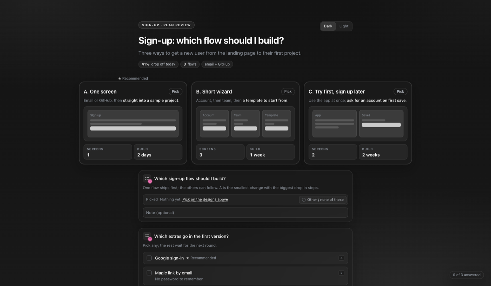
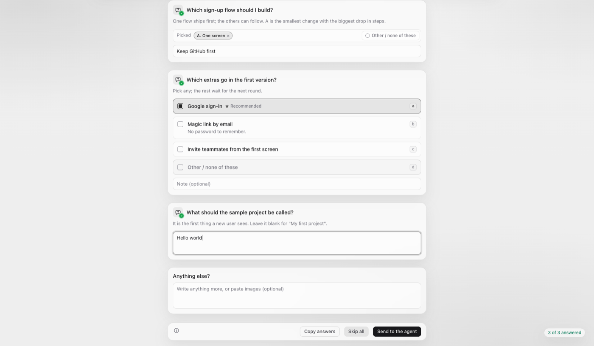
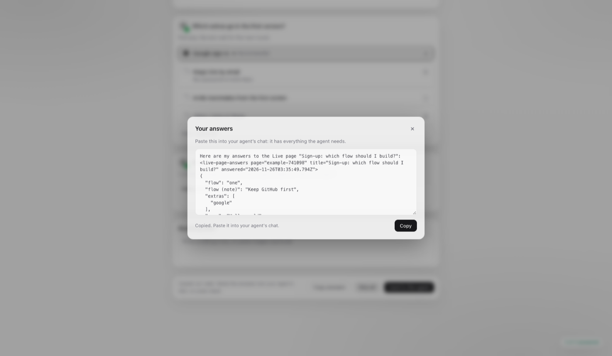

# Live page

One skill that lets any coding agent show you a **Live page** and get your answers back.

Ask your agent for a Live page (a mockup to react to, a report, options side by side, a chart, a
plan) and it writes one self-contained HTML page, opens it in your browser, and waits. You click
your picks, add notes, press **Send**, and the agent gets exactly what you picked and typed, then
carries on.



It works in Claude Code, Codex, Cursor CLI, OpenCode, Copilot CLI and Pi, on macOS, Linux and
Windows. It is one skill folder: the instructions, Ghostex's page kit and one small Node script
(standard library only). No account, no service, nothing to host.

## How it works

1. The agent writes the page with the page kit's markup: questions with choices, pick any,
   recommended picks, notes, Pick buttons on mockups, an "Anything else?" box and Send.
2. `live-page.mjs show page.html` checks the page, serves it on `127.0.0.1` (a random port and a
   random key in the link) and opens it in your browser.
3. You answer and press Send. The script saves your answers to a file at once, and the agent's
   `live-page.mjs wait` returns them. Answers are kept until the agent reads them, so nothing is
   lost if it was not waiting.

And a fallback that always works: **Copy answers** copies a ready-to-paste block you paste into the
agent's chat.

<p>
  
  
</p>

## Install

Node 18 or newer must be on your PATH (it already is wherever an npm-installed agent CLI runs).
Pick one route per agent.

<details open>
<summary><strong>Claude Code</strong> (plugin marketplace)</summary>

```bash
claude plugin marketplace add maddada/live-page-skill
claude plugin install live-page@live-page
```

</details>

<details open>
<summary><strong>Codex</strong> (plugin marketplace)</summary>

```bash
codex plugin marketplace add maddada/live-page-skill
codex plugin add live-page@live-page
```

</details>

<details open>
<summary><strong>Cursor CLI, OpenCode, Copilot CLI, Pi and others</strong> (skills.sh)</summary>

```bash
npx skills@latest add maddada/live-page-skill            # asks which agents
npx skills@latest add maddada/live-page-skill -a cursor  # or -a opencode, -a pi, -a github-copilot, -a claude-code, -a codex
```

Add `-g` to install for your user instead of this project. Update with `npx skills@latest update`.

</details>

<details>
<summary><strong>By hand</strong> (any agent that reads skill folders)</summary>

Copy `skills/live-page/` into your project's `.claude/skills/` (Claude Code) or `.agents/skills/`
(Codex, Cursor, OpenCode, Pi and others), or into the same folders under your home directory.

```bash
git clone https://github.com/maddada/live-page-skill
cp -R live-page-skill/skills/live-page .agents/skills/
```

</details>

## Use it

Ask in plain words: "make me a Live page comparing these three layouts", "show me the plan as a Live
page and ask what to do next", "use the live-page skill". The agent writes the page, shows it and
waits.

How each agent gets the answers back:

| Agent | Waits by | Tested on macOS |
| --- | --- | --- |
| Claude Code | `wait` as a background command; it is woken when you press Send | yes, Send and Copy answers |
| Codex | `wait` in the turn (with a long timeout, repeated if it runs out) | yes, Send and Copy answers |
| Cursor CLI | `wait` in the turn | yes, Send |
| Pi | `wait` in the turn | yes, Send |
| OpenCode | `wait` in the turn, repeated every 2 minutes (its shell timeout) | yes, Send and Copy answers |
| Copilot CLI | `wait` in the turn | not yet |

If the agent stopped waiting (or you answered a day later), say "I answered the page": it reads the
saved answers with `live-page.mjs answers`. Or press **Copy answers** and paste.

Starting `opencode run` from a script or another tool? Set `PWD` to the project folder as well as
the working directory: OpenCode takes its project folder from `$PWD` first, and in a folder other
than the one the skill is installed in it cannot load the skill ("Unable to load skill live-page").
A shell does this for you.

In a VS Code or Cursor terminal the script does not open a browser: the agent gives you the link to
open in the editor's built-in browser (VS Code: Command Palette, "Simple Browser: Show").
`show --app` opens the page in a Chrome, Edge or Brave app window instead of a tab.

## Inside Ghostex

[Ghostex](https://github.com/maddada/Ghostex) has Live pages built in (in the chat, on the phone,
with answers that come back as the agent's next message), so in a Ghostex session the skill steps
aside and tells the agent to use `ghostex show` instead. The pages are the same format, so a page
written for one works in the other.

## Safety

The server listens on `127.0.0.1` only. Every link carries a random key; requests without it, with
another `Host` (DNS rebinding) or posted from another site are refused. It serves only the shown
page and files in that page's folder. State lives in `~/.live-page` (`LIVE_PAGE_HOME` moves it):
the server's port and key, and per page its snapshot, draft, answers and pasted images.

## The script

```text
node live-page.mjs new <file.html> --title "..."   a page skeleton
node live-page.mjs check <file.html>                the page checks (errors stop show)
node live-page.mjs show <file.html>                 serve and open; prints the link and page id
node live-page.mjs wait [<page>] [--timeout <s>]    block until Send; print the answers
node live-page.mjs answers [<page>]                 the answers now, without waiting
node live-page.mjs list | stop | doctor | selftest
node live-page.mjs export <file.html>               a standalone copy that needs no server
```

## Develop

```bash
npm test          # the whole loop with no browser or agent (also: node skills/live-page/scripts/live-page.mjs selftest)
npm run check     # frontmatter, manifests, and nothing private or off-style in the repo
git config core.hooksPath .githooks   # run that check before every commit
```

[docs/windows-smoke.md](docs/windows-smoke.md) has the Windows steps.

## License

MIT, see [LICENSE](LICENSE). The page kit in `skills/live-page/kit/` comes from Ghostex, also MIT
([NOTICE](skills/live-page/kit/NOTICE.md)).
